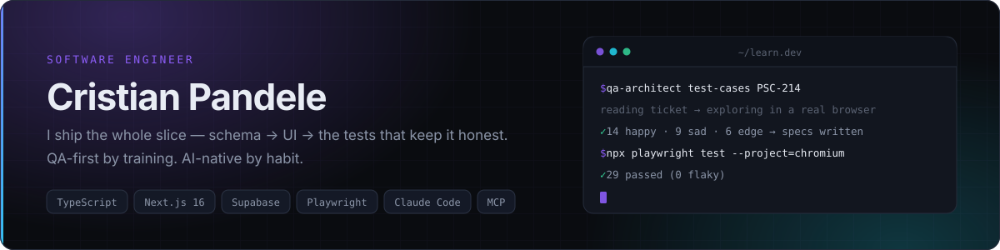
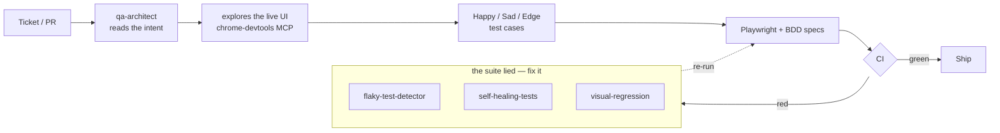

<picture>
  <source media="(prefers-color-scheme: dark)" srcset="assets/header-dark.svg">
  <source media="(prefers-color-scheme: light)" srcset="assets/header-light.svg">
  
</picture>

 

 &nbsp;

---

### ◆ About

I build user-facing web apps end-to-end — from Postgres schemas and RLS policies, through Server
Components, out to Playwright suites that actually catch regressions. I came up through QA, so I
tend to design features around the failure modes first and make the happy path fall out of that.

These days most of my work has an agent somewhere in the loop: writing the tests, triaging the
digest, reading the ticket. I still own the diff.

- 🌍 Trilingual UI by default — **EN / RO / CS**
- 🧪 Reformed manual tester — I write the tests *with* the feature, not after
- 📬 Best reached on **[LinkedIn](https://www.linkedin.com/in/cristian-p-sqa/)**

---

### ◆ Now

| Project | What's happening |
|---|---|
| 🩺 **Chronicare** *(private)* | Repositioning the chronic-condition tracker IBD-wide. Two-week digests, an in-app agent with write tools, GDPR export/delete, and a Kotlin Multiplatform client sharing one Supabase backend. |
| 🧰 **[claude-qa-architect](https://github.com/CristianPGit/claude-qa-architect)** | Merged eight sibling QA projects into one monorepo — 2 Claude Code plugins, 3 CLIs, 9 subagents, and a real E2E suite to prove it works. |
| 🎓 **[AI Web QA course](https://github.com/nebius-academy-templates/ai-web-qa-course)** | Writing workshop material on AI-assisted web QA — sprint gates, adversarial fixtures, and an offline-first track that needs no API key. |
| 🖼️ **market-watch** *(private)* | A twice-daily art-auction digest running for free on GitHub Actions, with the git repo itself as the datastore. |

---

### ◆ Stack

<table>
<tr>
<td valign="top" width="25%">

**Product**

</td>
<td valign="top" width="25%">

**Data**

</td>
<td valign="top" width="25%">

**Quality**

</td>
<td valign="top" width="25%">

**AI**

</td>
</tr>
</table>

---

### ◆ AI stack

Two different jobs, two different setups: **agents that help me build**, and **AI that ships inside
the product**. The rule that governs both — nothing model-shaped is allowed to be load-bearing
without a deterministic path underneath it.

| Layer | What I run | Where it lives |
|---|---|---|
| 🧠 **Models** | Claude Haiku 4.5 (default) · Groq · Gemini | picked per task on cost / latency, not on vibes |
| 🔀 **Routing** | Vercel AI Gateway → Groq → Gemini → **rule-based engine** | one `ai-client.ts`; the app is fully usable with zero AI keys |
| 🧩 **App layer** | Vercel **AI SDK 6** — streaming, tool calling, `@ai-sdk/react` | an in-app agent that reads *and* writes, behind confirm cards |
| 🔌 **Protocol** | **MCP** server route (`/api/mcp/[transport]`) | the product's own data exposed as tools, same contract as the in-app agent |
| 🤖 **Harness** | **Claude Code** — plugins, skills, subagents, hooks | `qa-architect` + `ticket-pilot`, 9 specialised subagents |
| 🖱️ **Browser control** | chrome-devtools MCP · playwright-cli | agents explore the real UI *before* they are allowed to write a test |
| 🧷 **Guardrails** | rule-based fallbacks · confirm-before-write · no-push boundaries | an agent that can't be trusted unattended isn't done |

<b>The QA loop I'm building toward</b>

 

Every box is a real tool in [`claude-qa-architect`](https://github.com/CristianPGit/claude-qa-architect) —
the point of the monorepo is that they hand off to each other instead of each being a clever demo.

---

### ◆ Featured

> 🧰 **[claude-qa-architect](https://github.com/CristianPGit/claude-qa-architect)** &nbsp;·&nbsp; *one toolchain for AI-assisted quality engineering*
> Claude Code plugins that turn Linear tickets and GitHub PRs into **Happy / Sad / Edge** cases and
> working branches; CLIs that hunt flakiness, heal broken selectors, and diff screenshots; a browser
> toolkit for the daily grind; and a live Playwright + BDD suite proving the whole chain.

> 🩺 **Chronicare** *(private)* &nbsp;·&nbsp; *a journal for living with a chronic condition*
> Mobile-first PWA in EN / RO / CS — check-ins, meals, lab markers, appointments, and a two-week
> digest with a hand-rolled activity index. **Next.js 16 · Supabase RLS · AI Gateway · Playwright ·
> Compose Multiplatform.**

> 🎓 **[ai-web-qa-course](https://github.com/nebius-academy-templates/ai-web-qa-course)** &nbsp;·&nbsp; *teaching the loop, not the tool*
> Workshop material for AI-assisted web QA, built against a real demo store: sprint gates, checkpoint
> solutions, adversarial fixtures, and a canned-generation mode so nobody is blocked on an API key.

> ⚡ **[techshop-demo](https://github.com/CristianPGit/techshop-demo)** &nbsp;·&nbsp; *[live](https://cristianpgit.github.io/techshop-demo/)*
> A deliberately imperfect e-commerce store — static site plus an Express API — used as the practice
> target for everything above. Seeded `data-testid`s, seeded bugs.

> 🥾 **[euro-trails-map](https://github.com/CristianPGit/euro-trails-map)** &nbsp;·&nbsp; *[live](https://cristianpgit.github.io/euro-trails-map/)*
> 66 of Europe's best long-distance hikes on one Leaflet map — difficulty, distance, season, and
> where to start walking.

---

### ◆ Activity

<picture>
  <source media="(prefers-color-scheme: dark)" srcset="https://github-profile-summary-cards.vercel.app/api/cards/profile-details?username=CristianPGit&theme=github_dark">
  
</picture>

<picture>
  <source media="(prefers-color-scheme: dark)" srcset="https://github-profile-summary-cards.vercel.app/api/cards/repos-per-language?username=CristianPGit&theme=github_dark">
  
</picture>
<picture>
  <source media="(prefers-color-scheme: dark)" srcset="https://github-profile-summary-cards.vercel.app/api/cards/most-commit-language?username=CristianPGit&theme=github_dark">
  
</picture>
<picture>
  <source media="(prefers-color-scheme: dark)" srcset="https://github-profile-summary-cards.vercel.app/api/cards/productive-time?username=CristianPGit&theme=github_dark&utcOffset=3">
  
</picture>

Public repos only — a good half of the commits above land in private ones.

---

### ◆ How I work

- **Tests are part of the design.** If a flow is hard to test, it's usually hard to use.
- **Every AI path has a deterministic fallback.** No keys, no network, no problem — the feature degrades, it doesn't disappear.
- **Agents get tools and boundaries, not vibes.** Read freely, write behind a confirmation, never push on my behalf.
- **RLS over service-role.** If I'm reaching for an escape hatch, the policy is wrong.
- **i18n from day one.** Hardcoded strings are a migration I'm not paying for later.
- **Small, readable diffs.** Then ship.

---

⚡ <i>"Make it correct, make it boring, then make it nice."</i>

  

Much of this is built with <a href="https://claude.com/claude-code">Claude Code</a> — and reviewed by a human before it lands.

